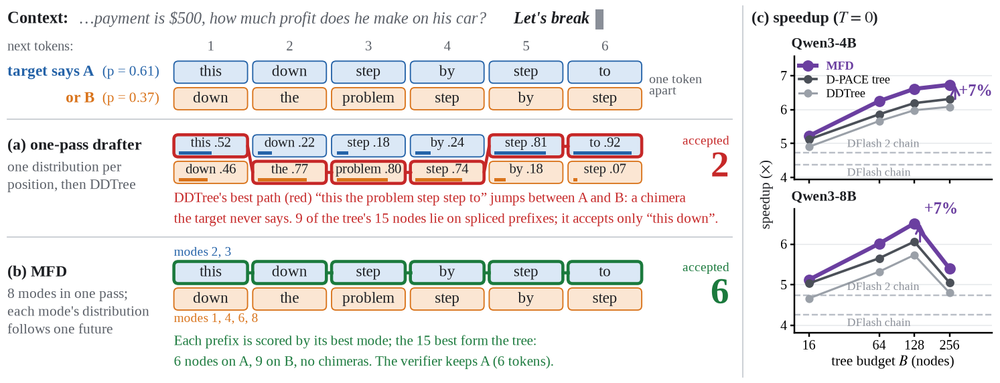
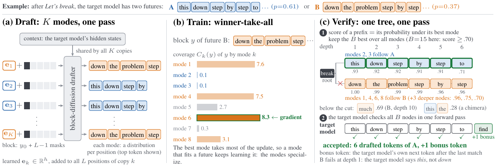

<div align="center">

<h1>Multi-Future Drafting</h1>
<h3>Mixture Block Drafters for Tree-Verified Speculative Decoding</h3>

<p>
  Haoyu Huang<sup>1,2</sup> &nbsp;·&nbsp; Jialiang Kang<sup>2</sup> &nbsp;·&nbsp; Linlin Yang<sup>3</sup> &nbsp;·&nbsp;
  Xiao Yang<sup>2</sup> &nbsp;·&nbsp; Baochang Zhang<sup>1</sup><br>
  <sup>1</sup>Beihang University &nbsp;&nbsp; <sup>2</sup>Canva Research &nbsp;&nbsp; <sup>3</sup>Communication University of China
</p>

<p>
  <a href="https://arxiv.org/abs/2611.13017"></a>
  <a href="https://hhhhhhy5.github.io/multi-future-drafting/"></a>
  <a href="https://huggingface.co/hhhhhhy5"></a>
  <a href="guides/SGLANG.md"></a>
  <a href="LICENSE"></a>
</p>



</div>

**TL;DR**

- 🧩 **The problem.** A draft tree ranked by the *product* of a block drafter's per-position distributions cannot keep futures apart. To hold two futures that differ in *m* positions it must also hold 2<sup>*m*−1</sup>−1 of their **chimeras**, prefixes spliced from both that the target never says. In practice, chimeras are 27–33% of a 64-node tree.
- 🎯 **MFD.** *K* = 8 learned mode embeddings at the drafter's input draft 8 coherent futures in the same forward pass. An exact **mixture tree** keeps the *B* prefixes with the highest best-mode probability. Verification is unchanged, so decoding stays **lossless**.
- 🚀 **Speed.** Up to **7.8×** over autoregressive decoding in Hugging Face Transformers and **6.4×** in SGLang, 5–12% faster than the strongest tree baseline trained on the same data, on Qwen3-4B / 8B, Qwen3.5-4B and Qwen3.6-27B.
- ⚙️ **MFD-D.** One drafter for every batch size: the mixture tree at batch sizes 1–2, a single-mode tree beyond, switched inside one SGLang engine.

## 🔥 News

- **2026-11** · The paper is on arXiv ([2611.13017](https://arxiv.org/abs/2611.13017)). Inference code, the SGLang patch and ten drafters are released under Apache-2.0.

## 📖 How it works

Block drafters such as [DFlash](https://arxiv.org/abs/2602.06036) draft a block of future tokens in one forward pass.
Draft trees such as [DDTree](https://arxiv.org/abs/2604.12989) then verify the prefixes ranked highest by the product
of the drafter's per-position distributions. When the continuation can follow several futures, the product splices
them into *chimeras*: prefixes stitched together from different futures that the target never produces. These
chimeras take tree budget from the futures themselves.

**MFD** restores the coupling with a latent variable. *K* learned mode embeddings at the drafter's input draft *K*
coherent blocks in the same forward pass. An exact **mixture tree** keeps the *B* distinct prefixes with the largest
best-mode log-probability, so the verifier can pick the future the target takes. Verification is unchanged, so
decoding stays lossless.

**MFD-D** adds a *default mode*: the same drafter without a mode embedding also works as a single-mode drafter. One
set of weights then serves the mixture at small batch sizes and a plain tree at large ones. The SGLang patch switches
between the two by batch size, inside one engine.

<p align="center">
  
</p>

<details>
<summary><b>One-minute animation</b> (the walkthrough from the project page)</summary>
<p align="center"></p>
</details>

## 📊 Results

Numbers from the paper. Speedup over autoregressive decoding of the same target, with the acceptance length τ in
parentheses; each cell is the mean over 5 tasks (GSM8K, MATH-500, HumanEval, MBPP, MT-Bench) at batch size 1 on one
NVIDIA RTX PRO 6000 Blackwell GPU, every tree method at its best budget.

**Hugging Face Transformers**

| Method (training) | Qwen3-4B T=0 | T=1 | Qwen3-8B T=0 | T=1 | Qwen3.5-4B T=0 | T=1 | Qwen3.6-27B T=0 | T=1 |
|---|---|---|---|---|---|---|---|---|
| DFlash chain (released) | 4.38x (5.98) | 3.73x (5.08) | 4.26x (5.99) | 3.48x (4.88) | 4.85x (6.25) | 3.29x (4.23) | 4.66x (5.81) | 4.04x (5.04) |
| DDTree (released) | 6.08x (8.59) | 5.44x (7.70) | 5.73x (8.18) | 5.00x (7.13) | 6.53x (8.78) | 4.77x (6.51) | 5.89x (7.62) | 5.27x (6.86) |
| D-PACE + DDTree (100K, 1 ep) | 6.31x (8.91) | 5.54x (7.84) | 6.06x (8.62) | 5.10x (7.26) | 6.96x (9.37) | 4.67x (6.37) | 6.43x (8.31) | 5.52x (7.19) |
| **MFD (100K, 3 ep)** | **6.73x** (9.71) | **5.96x** (8.63) | **6.51x** (9.47) | **5.43x** (7.89) | **7.31x** (10.07) | **5.04x** (7.03) | **6.77x** (8.91) | **5.94x** (7.87) |
| DARTree (released) | 6.53x (9.97) | 5.49x (8.34) | 6.42x (10.09) | 5.23x (8.11) | - | - | - | - |
| D-PACE + DDTree (1.42M, 3 ep) | 6.66x (9.34) | 5.66x (7.96) | 6.43x (9.18) | 5.26x (7.48) | 7.31x (9.82) | 4.74x (6.46) | 6.74x (8.72) | 5.69x (7.40) |
| **MFD (1.42M, 3 ep)** | **7.32x** (10.49) | **6.35x** (9.13) | **6.98x** (10.18) | **5.88x** (8.52) | **7.78x** (10.72) | **5.18x** (7.23) | **7.16x** (9.42) | **6.16x** (8.16) |

Qwen3.5-4B and Qwen3.6-27B are hybrid Gated-DeltaNet targets, run in thinking mode. Their trees are verified exactly
by the tree kernels of `inference/hf/qwen35_tree.py`.

**SGLang** (v0.5.22 with this patch, CUDA graphs, batch size 1, the same 5 tasks, B = 63, 64K draft vocabulary)

| Method | Qwen3-4B T=0 | T=1 | Qwen3-8B T=0 | T=1 |
|---|---|---|---|---|
| DFlash chain (released, SGLang native) | 4.06x (5.97) | 3.46x (5.10) | 4.39x (5.90) | 3.62x (4.88) |
| DDTree (released drafter, this patch) | 4.97x (7.81) | 4.44x (6.99) | 5.27x (7.79) | 4.56x (6.74) |
| D-PACE + DDTree (1.42M) | 5.52x (8.72) | 4.72x (7.48) | 5.99x (8.84) | 4.82x (7.15) |
| **MFD** | **5.93x** (9.62) | 5.06x (8.23) | **6.43x** (9.72) | **5.26x** (7.96) |
| **MFD-D** | 5.89x (9.59) | **5.11x** (8.27) | 6.41x (9.69) | 5.24x (7.95) |

The mixture pays off at batch sizes 1-2. From batch 8 on, a single-mode tree serves faster. The MFD-D switch engine
stays within a few percent of the best configuration at every batch size from 1 to 32 (see
[guides/SGLANG.md](guides/SGLANG.md)).

## 🤗 Released drafters

Each drafter is a DFlash-format checkpoint (`config.json` + `model.safetensors`) with K = 8 mode embeddings. All of
them fine-tune the released [z-lab](https://huggingface.co/z-lab) DFlash drafter of their target on
target-regenerated responses. Two prompt sets are used: *100K* is the DFlash training prompts, and *1.42M* is the
open-perfectblend prompts, the data of Domino and DARTree.

| Drafter | Target | Data, epochs | Paper | Hugging Face |
|---|---|---|---|---|
| MFD | Qwen3-4B | 1.42M, 3 | Table 1 (full data), Table 2 | [hhhhhhy5/MFD-Qwen3-4B](https://huggingface.co/hhhhhhy5/MFD-Qwen3-4B) |
| MFD | Qwen3-8B | 1.42M, 3 | Table 1 (full data), Table 2 | [hhhhhhy5/MFD-Qwen3-8B](https://huggingface.co/hhhhhhy5/MFD-Qwen3-8B) |
| MFD | Qwen3.5-4B (thinking) | 1.42M, 3 | Table 1 (full data) | [hhhhhhy5/MFD-Qwen3.5-4B](https://huggingface.co/hhhhhhy5/MFD-Qwen3.5-4B) |
| MFD | Qwen3.6-27B (thinking) | 1.42M, 3 | Table 1 (full data) | [hhhhhhy5/MFD-Qwen3.6-27B](https://huggingface.co/hhhhhhy5/MFD-Qwen3.6-27B) |
| MFD | Qwen3-4B | 100K, 3 | Table 1 | [hhhhhhy5/MFD-Qwen3-4B-100K](https://huggingface.co/hhhhhhy5/MFD-Qwen3-4B-100K) |
| MFD | Qwen3-8B | 100K, 3 | Table 1 | [hhhhhhy5/MFD-Qwen3-8B-100K](https://huggingface.co/hhhhhhy5/MFD-Qwen3-8B-100K) |
| MFD | Qwen3.5-4B (thinking) | 100K, 3 | Table 1 | [hhhhhhy5/MFD-Qwen3.5-4B-100K](https://huggingface.co/hhhhhhy5/MFD-Qwen3.5-4B-100K) |
| MFD | Qwen3.6-27B (thinking) | 100K, 3 | Table 1 | [hhhhhhy5/MFD-Qwen3.6-27B-100K](https://huggingface.co/hhhhhhy5/MFD-Qwen3.6-27B-100K) |
| MFD-D | Qwen3-4B | 1.42M, 3 | Table 2, Figure 5 | [hhhhhhy5/MFD-D-Qwen3-4B](https://huggingface.co/hhhhhhy5/MFD-D-Qwen3-4B) |
| MFD-D | Qwen3-8B | 1.42M, 3 | Table 2, Figure 5 | [hhhhhhy5/MFD-D-Qwen3-8B](https://huggingface.co/hhhhhhy5/MFD-D-Qwen3-8B) |

## 🛠️ Install

Tested on Linux x86_64 with NVIDIA RTX PRO 6000 Blackwell GPUs (driver 590, CUDA 13.1). You need
[uv](https://docs.astral.sh/uv/), git and a C++ compiler (the tree builder is a PyTorch C++ extension).

```bash
git clone https://github.com/hhhhhhy5/multi-future-drafting.git mfd && cd mfd

# HF inference environment (Python 3.11, PyTorch 2.13, Transformers 5.12)
uv venv .venv-hf -p 3.11 --seed
source .venv-hf/bin/activate
uv pip install -r inference/hf/requirements.txt
source inference/env.sh

# serving environment, in another shell: SGLang v0.5.22 + inference/sglang/patches/sglang-v0.5.22-mfd.patch
bash inference/sglang/install.sh          # creates .venv-sglang
source .venv-sglang/bin/activate && source inference/sglang/env.sh
```

## 🚀 Quickstart

**Decode with the mixture tree** (HF environment, run from `inference/hf`):

```python
import torch
from transformers import AutoModelForCausalLM, AutoTokenizer
from model import DFlashDraftModel
from ddtree import ddtree_generate, enable_cpp_tree, enable_mode_attention

target = AutoModelForCausalLM.from_pretrained("Qwen/Qwen3-4B", attn_implementation="sdpa", dtype=torch.bfloat16).cuda().eval()
draft = DFlashDraftModel.from_pretrained("hhhhhhy5/MFD-Qwen3-4B", attn_implementation="sdpa", dtype=torch.bfloat16).cuda().eval()
tok = AutoTokenizer.from_pretrained("Qwen/Qwen3-4B")
text = tok.apply_chat_template([{"role": "user", "content": "What is 17 * 23?"}], tokenize=False,
                               add_generation_prompt=True, enable_thinking=False)
ids = tok.encode(text, return_tensors="pt").cuda()
enable_cpp_tree(True, fused_logits=True)   # the benchmark's fast tree construction
enable_mode_attention(True)                # the Triton mode-attention kernel
out = ddtree_generate(model=draft, target=target, input_ids=ids, mask_token_id=draft.mask_token_id,
                      max_new_tokens=512, block_size=draft.block_size, tree_budget=256,
                      stop_token_ids=[tok.eos_token_id], temperature=0.0)
print(tok.decode(out.output_ids[0, ids.shape[1]:]), sum(out.acceptance_lengths) / len(out.acceptance_lengths))
```

**Speed benchmark** (HF environment). The autoregressive baseline and every drafter run back to back on each prompt.
The full protocol of Table 1 is in [guides/INFERENCE_HF.md](guides/INFERENCE_HF.md):

```bash
cd inference/hf
python benchmark.py --model-name-or-path Qwen/Qwen3-4B --dataset gsm8k --max-samples 128 --temperature 0 \
    --max-new-tokens 2048 --tree-impl fast --draft-attn triton \
    --draft mfd=hhhhhhy5/MFD-Qwen3-4B:tb64,tb256 --draft ddtree=z-lab/Qwen3-4B-DFlash-b16:linear,tb64,tb256 \
    --save-path ../../runs/qwen3-4b/gsm8k.t0.pt
python summarize.py ../../runs/qwen3-4b/*.t0.pt
```

**SGLang serving** (serving environment):

```bash
bash inference/sglang/launch_server.sh --model Qwen/Qwen3-4B --draft hhhhhhy5/MFD-Qwen3-4B \
    --draft-vocab inference/sglang/vocab/draft_vocab_qwen3-4b_64k.json \
    --engine-config inference/sglang/configs/mfd-b63.env --port 30000
python inference/sglang/bench_client.py --url http://127.0.0.1:30000 --model Qwen/Qwen3-4B --task gsm8k \
    --num-prompts 128 --concurrency 1 --temperature 0 --max-new-tokens 2048
```

To serve one engine at every batch size, use an MFD-D drafter with
`--engine-config inference/sglang/configs/mfdd-switch-qwen3-4b.env --max-running-requests 32`. It runs the mixture
at batch sizes 1-2 and the default path from 3 on.

## ✅ Tests

```bash
# CPU (HF environment)
python -m unittest tests.test_mixture_tree tests.test_gdn_tree_math tests.test_sglang_tree_builder
# GPU
CUDA_VISIBLE_DEVICES=0 python tests/test_hf_exactness.py          # T=0 mixture tree == AR (HF environment)
MFD_TEST_GPU=0 bash tests/test_sglang_exactness.sh                # T=0 MFD server == AR server (serving environment)
for t in tests/sglang_kernels/test_*.py; do CUDA_VISIBLE_DEVICES=0 python $t; done   # engine kernels (serving)
```

By default, the GPU tests download `hhhhhhy5/MFD-Qwen3-4B`. To test another drafter, set `MFD_TEST_DRAFTER` to a local
directory or a Hugging Face repo id.

## 🗂️ Repository layout

```
README.md               this file
docs/                   the project page (served by GitHub Pages from `main`, `/docs`); the guides are below
guides/INFERENCE_HF.md  decoding API, the mixture tree, exact tree verification for hybrid targets, the speed benchmark
guides/SGLANG.md        every change to SGLang v0.5.22: where, why, measured effect, how to enable it
inference/env.sh        CUDA_HOME from the virtualenv's pip CUDA toolkit (sourced by both environments)
inference/hf/           HF inference and the speed benchmark (derived from DDTree)
inference/sglang/       patch against SGLang v0.5.22, install, launch presets, benchmark client, draft vocabularies
tests/                  mixture tree, GDN tree math, SGLang tree builder (CPU); HF / SGLang exactness and kernels (GPU)
LICENSE, NOTICE         Apache License 2.0 for this repository's own code; third-party notices
```

The training code is not included.

## 📝 Citation

```bibtex
@article{huang2026mfd,
  title={Multi-Future Drafting: Mixture Block Drafters for Tree-Verified Speculative Decoding},
  author={Huang, Haoyu and Kang, Jialiang and Yang, Linlin and Yang, Xiao and Zhang, Baochang},
  journal={arXiv preprint arXiv:2611.13017},
  year={2026}
}
```

## 🙏 Acknowledgements

The HF inference code is derived from [DDTree](https://github.com/liranringel/ddtree); the drafters start from the
[z-lab](https://huggingface.co/z-lab) [DFlash](https://arxiv.org/abs/2602.06036) checkpoints; serving builds on
[SGLang](https://github.com/sgl-project/sglang) v0.5.22. D-PACE and DARTree are the tree baselines of the paper.

## 📄 License

The code written for this repository is released under the Apache License 2.0 ([LICENSE](LICENSE)). The third-party
code it contains or modifies keeps its own license: DDTree (MIT, `inference/hf/LICENSE`) and SGLang (Apache-2.0,
`inference/sglang/patches/LICENSE-SGLANG`); see [NOTICE](NOTICE). The released drafters on Hugging Face are
Apache-2.0 as well.
